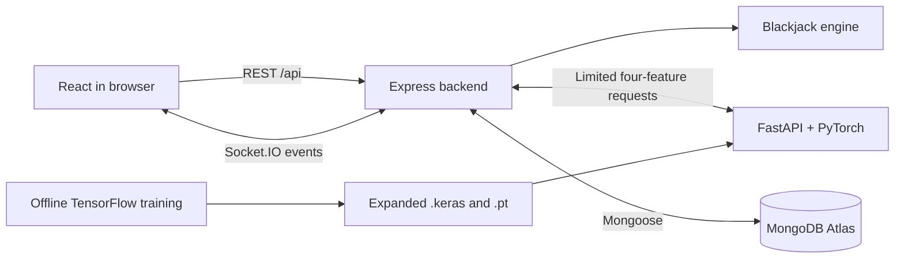

# 01 — Project overview

Blackjack Arena lets a person play simplified Blackjack, invite friends into a
private table, and study HIT/STAND recommendations from a small trained network.
Accounts keep personal history and win/loss/push totals. Nothing represents money.

Think of three running programs and one database. React draws the website.
Express owns game rules and identity. FastAPI runs the saved neural network.
MongoDB keeps account and completed-round data after the programs stop.

The browser must never decide which card to draw. A browser user can edit their
own JavaScript, so trusting the browser would allow cheating. Express draws cards,
checks the active player, and returns only permitted state. The remaining shoe and
hidden dealer card stay inside the backend until the round finishes.

## Technologies in everyday terms

| Tool | Job in this project |
| --- | --- |
| React | Rebuild the displayed interface when state changes |
| Vite | Local frontend server and production frontend build |
| React Router | Choose a page from the browser URL |
| Express | Match HTTP requests with JavaScript functions |
| Socket.IO | Send room updates without repeatedly refreshing |
| Mongoose | Describe database documents and run MongoDB queries |
| MongoDB Atlas | Hosted persistent document database |
| TensorFlow | Train weights offline using labeled examples |
| PyTorch | Load converted weights and run inference |
| FastAPI | Offer model inference through an internal HTTP API |

## Read the project in this order

1. `backend/src/game/engine.js`: scoring and result functions are independent of web code.
2. `backend/tests/engine.test.js`: concrete examples of the rules.
3. `backend/src/services/games.js`: connect turns, bots, rooms, and saving.
4. `backend/src/routes/index.js` and `sockets.js`: network entry points.
5. `frontend/src/pages/SinglePlayer.jsx` and `components/GameTable.jsx`: display and actions.
6. `ai-service/expanded_states.py`, training, and API: the machine-learning path.

The original proposal describes intended work. The verification report describes
what was actually executed. Keep those separate in your final report.

## Exercise

Start the three services. Open the browser's Network tab, register, and deal a
round with zero bots. Find `/api/games/single` and inspect its response. Confirm
that the second dealer card is `{ "hidden": true }` and that no `shoe` property
exists. Stand, then observe when the complete dealer hand becomes visible.
