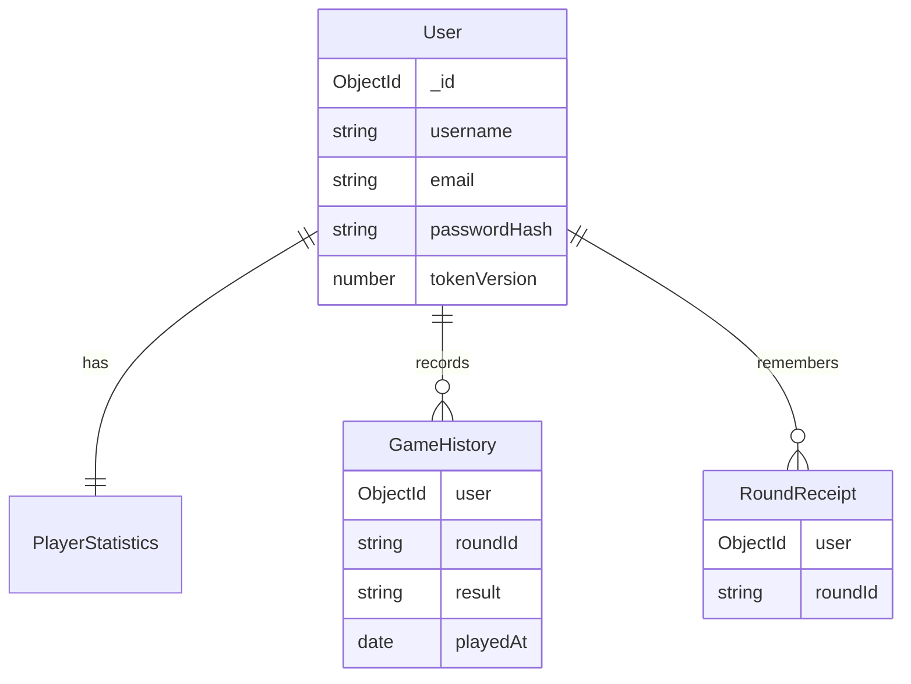

# 05 — MongoDB and Mongoose explained

MongoDB stores documents in collections. A document resembles a JavaScript
object but has a persistent ID. Mongoose defines expected fields and offers
methods such as `findOne`, `create`, and `findOneAndUpdate`.

## Four collections

| Model | Main fields | Meaning |
| --- | --- | --- |
| `User` | username, email, passwordHash, tokenVersion, createdAt | Account and session revocation |
| `GameHistory` | user, roundId, mode, result, playerTotal, dealerTotal, playedAt | One human's completed round; at most 20 per user |
| `PlayerStatistics` | user, totalGames, wins, losses, pushes, winPercentage | Cumulative personal counts |
| `RoundReceipt` | user, roundId | Durable key recording that a round was already saved |

The definitions are in `backend/src/models/index.js`. Mongoose pluralizes names
into collection names. A `user` field is an ObjectId reference to `User`; history
does not duplicate the user's email or password.



## CRUD in the actual app

Create: registration inserts a user and a statistics document. Completing a
round records each human's outcome, including a human who stood because of
disconnection or timeout. Each new save also creates a receipt. Bots do not have
account records.

Read: the history endpoint calls `getHistory(authenticatedUserId)`. It returns at
most 20 records ordered by `playedAt` descending, then `_id` descending for equal
timestamps. There are no additional pages; only an optional `page=1` is accepted.
Supplying another user ID in a query does not change the authenticated ID passed
to the repository.

Update: completing a round increments the corresponding outcome counter and
`totalGames`. The transaction recalculates `winPercentage = wins / totalGames * 100`,
rounded to two decimals. Pushes count in the denominator. Logout increments
`tokenVersion` to revoke sessions.

Delete: saving a round trims that user's history to the newest 20 records across
both game modes. Saving record 21 normally deletes the oldest. Lifetime statistics
are not recomputed from the retained rows: deleting history never subtracts games,
wins, losses, or pushes, and never changes the lifetime win percentage.
The product has no account-deletion feature. Integration test teardown removes
the exact disposable account IDs it created and their linked records; database
startup also runs the retention cleanup described below.

## Transactions and duplicate protection

Imagine a new history record saves but its lifetime counter update fails. That
round would appear in history without being counted. `database.saveRound` wraps all humans'
history, receipts, counter updates, and pruning in one MongoDB transaction:
everything commits together or rolls back. Atlas supports this; a local MongoDB
must run as a replica set rather than a standalone server.

```js
await mongoose.connection.transaction(async session => {
  // Every read/write in this group receives the same session.
});
```

`GameHistory` and `RoundReceipt` each have a unique compound index on
`{user, roundId}`. A receipt contains no hand, result, or timestamp; it means
“this user's round has already been counted.” It stays after history is pruned,
so retrying a deleted round cannot recreate its history or increment statistics.
The 20-record limit applies to history, not these minimal receipts or lifetime
totals. Existing history is also checked for older saves that predate receipts.

Before checking receipts or pruning, `lockUserHistory` writes the user's statistics
document by incrementing its internal `__v` counter. Concurrent saves or cleanup
for that user then conflict on the same document, and the Mongoose/MongoDB driver
transaction helper retries transient conflicts. Lifetime counters increase only
for a previously uncounted round.
The JavaScript game's `saved` flag avoids unnecessary save requests; persisted
receipts and transaction checks provide durable protection.

## Existing-history cleanup

`connectDatabase` waits for indexes and calls `cleanupHistory` before the server
listens. Cleanup streams users with more than 20 history rows and removes excess
rows in transactions of at most 200 deletions. It uses the same ordering and
per-user coordination as saving. Before deleting a legacy row it creates a
receipt in the same transaction. A later startup can resume interrupted cleanup
without recounting rounds or changing lifetime statistics.

Username/email uniqueness is enforced by indexes. A duplicate registration
receives HTTP 409.
Passwords are stored only as bcrypt hashes and excluded by default from queries.

## Failure behavior

If initial connectivity fails, startup stops. If a completed-round save fails,
the result remains on screen with a Retry saving button. Starting another round
is blocked until saving succeeds. Unsaved results and active games still live
only in Node memory and can be lost if Node restarts; do not call them durable.

## Exercise

Using a disposable database and account, finish a round and find its history and
receipt documents. Compare the user's ObjectId with the statistics reference.
Request saving again and verify that total games does not increase. The retention
integration test also covers saving 21 rounds, concurrent retries, rollback, and
legacy cleanup. Use a disposable database because startup enforces retention for
existing users, as well as cleaning up the test accounts afterward.
