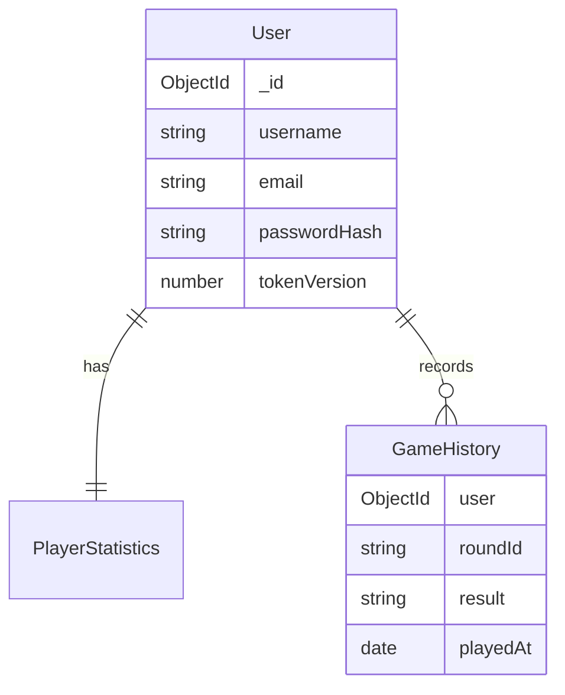

# 05 — MongoDB and Mongoose explained

MongoDB stores documents in collections. A document resembles a JavaScript
object but has a persistent ID. Mongoose defines expected fields and offers
methods such as `findOne`, `create`, and `findOneAndUpdate`.

## Three collections

| Model | Main fields | Meaning |
| --- | --- | --- |
| `User` | username, email, passwordHash, tokenVersion, createdAt | Account and session revocation |
| `GameHistory` | user, roundId, mode, result, playerTotal, dealerTotal, playedAt | One human's completed round |
| `PlayerStatistics` | user, totalGames, wins, losses, pushes, winPercentage | Cumulative personal counts |

The definitions are in `backend/src/models/index.js`. Mongoose pluralizes names
into collection names. A `user` field is an ObjectId reference to `User`; history
does not duplicate the user's email or password.



## CRUD in the actual app

Create: registration inserts a user and a statistics document. Completing a
round inserts one history document for each human, including a human who stood
because of disconnection. Bots do not have account records.

Read: the history endpoint calls `getHistory(authenticatedUserId, page)`. It sorts
newest first and returns 20 records per page. Supplying another user ID in a query
does not change the authenticated ID passed to the repository.

Update: completing a round increments the corresponding outcome counter and
`totalGames`. The transaction recalculates `winPercentage = wins / totalGames * 100`,
rounded to two decimals. Pushes count in the denominator. Logout increments
`tokenVersion` to revoke sessions.

Delete: the product has no account-deletion feature. Integration tests remove
only the exact disposable account IDs they created and their linked records.

## Transactions and duplicate protection

Imagine history saves successfully but statistics fail. Without a transaction,
the two collections would disagree. `database.saveRound` wraps all humans' records
and statistics in one MongoDB transaction: everything commits together or rolls
back. Atlas supports this; a standalone local MongoDB needs a replica set.

```js
await mongoose.connection.transaction(async session => {
  // Every read/write in this group receives the same session.
});
```

`GameHistory` has a unique compound index on `{user, roundId}`. Within the
transaction the service checks whether that history already exists and skips it.
The index also protects against races. Retrying a completed save cannot increment
statistics again. The JavaScript game's `saved` flag avoids unnecessary requests,
while database uniqueness is the durable protection.

Username/email uniqueness is enforced by indexes. Startup waits for indexes
before opening the HTTP server. A duplicate registration receives HTTP 409.
Passwords are stored only as bcrypt hashes and excluded by default from queries.

## Failure behavior

If initial connectivity fails, startup stops. If a completed-round save fails,
the result remains on screen with a Retry saving button. Starting another round
is blocked until saving succeeds. Unsaved results and active games still live
only in Node memory and can be lost if Node restarts; do not call them durable.

## Exercise

Using only a disposable account, finish a round and find its history document in
Atlas. Compare the user's ObjectId with the statistics reference. Request saving
again and verify that total games does not increase. The integration test automates
this check without touching unrelated users.
