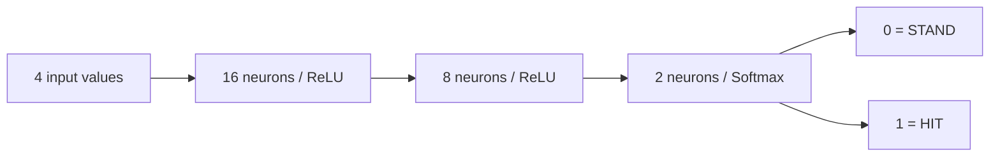

# 07 — Neural network explained

The model is a small feedforward multilayer perceptron. It imitates labeled
HIT/STAND strategy decisions through supervised learning. It does not receive
wins as rewards, learn continuously, count all undealt cards, or guarantee success.

## Four inputs and their meaning

| Position | Feature | Example | Expanded normalization |
| --- | --- | --- | --- |
| 1 | Player's best hand total | 16 | divide by 21 |
| 2 | Dealer's visible value (Ace=11) | 10 | divide by 11 |
| 3 | Usable Ace, 0 or 1 | 0 | divide by 1 |
| 4 | Number of player cards | 2 | divide by 20 |

For `[16,10,0,2]`, normalized input is approximately
`[0.7619,0.9091,0,0.1]`. Training and inference call the same
`normalize_expanded` function. The original model used divisor 6 for card count;
its preserved weights must not be combined with divisor 20.

The input has no dealer hidden card, shoe order, username, or match history.
Card count is included to preserve the proposed four-input architecture even
though the reference label rules depend on total, upcard, and usable Ace.

## Architecture and 234 parameters



Every dense neuron has weights for its inputs and one bias:

| Layer | Weights | Biases | Total |
| --- | --- | --- | --- |
| First hidden | 4 × 16 = 64 | 16 | 80 |
| Second hidden | 16 × 8 = 128 | 8 | 136 |
| Output | 8 × 2 = 16 | 2 | 18 |
| Overall | 208 | 26 | **234** |

Input values themselves are not trainable weights. ReLU and Softmax add no
trainable parameters.

## Forward propagation

A dense layer computes `z = input × weights + bias`. ReLU applies
`max(0,z)` element by element. The next layer repeats the process. The last layer
turns its two logits into Softmax scores:

```text
score(action) = exp(logit(action)) / sum(exp(each logit))
```

The implementation uses the frameworks' stable Softmax routines rather than
manually exponentiating large numbers. The largest output selects the action.
The original `torch_network` explicitly returns Softmax over dimension 1. A
score of 0.8 for HIT is the classifier's preference for that action class; it is
not an 80% chance of winning. Calibration of those scores was not measured.

## Labels, loss, and learning

`basic_strategy` in the original script assigns class 0 or 1 to a legal state
using the agreed six-deck S17 HIT/STAND reference. It is used for labels,
evaluation, and explanation support, not live fallback decisions.

Sparse categorical cross-entropy for one correct label is
`loss = -log(score(correct class))`. A confident wrong answer incurs more loss
than a slightly uncertain correct answer. The reported test loss is an average
over held-out states; it is not the number of lost Blackjack games.

Backpropagation computes how the loss changes with each weight through the chain
rule. Adam uses these gradients to update weights (initial learning rate 0.001).
The process repeats with minibatches of 32. One epoch is one pass through the
training partition. Early stopping watches validation loss and can restore the
best weights. No optimizer update occurs inside `/predict`.

## Fixing the original six-card limitation

The original script randomly sampled only 2–6 cards, normalized count by 6, and
the original API rejected larger hands. Simply accepting a larger number or
clipping 8 to 6 would not fix the learned input distribution.

`expanded_states.py` explores reachable legal hand snapshots. It keeps a real
witness hand for each distinct minimum sum, Ace presence, and count. When a hand
reaches 21 it stops expanding, matching the live engine. Values 10/J/Q/K are
equivalent for these features; Aces are represented as 11 before scoring.

For a non-busting hand the minimum sum cannot exceed 21. Such a hand cannot use
more than the 24 copies of any rank available in six decks, and a dealer upcard
of every rank remains available. This allows a small exact feature enumeration
without simulating all 312-card permutations. It does not model card-composition
strategy or claim every state has equal real-game frequency.

The maximum reachable non-busting count is 20. Twenty-one cards would require
all Aces to remain at a minimum total of 21, but that sequence already hits soft
21 after eleven Aces and stops. A legal 20-card hand can be nineteen Aces and a 2,
with the 2 added before an all-Ace prefix reaches 21. Nonterminal requests top
out at 19 cards; the API also validates the terminal 20-card state. Bust hands
never request advice. There is no clipping.

## Training, conversion, and loading

`train_expanded.py` imports the original architecture, strategy, seed, split
method, and exporter. The separate expanded artifacts preserve the original
experiment. Distinct feature tuples are split approximately 70/15/15, stratified
by class, into training/validation/test. These indices do not overlap.

TensorFlow trains and saves `.keras`. The exporter copies each Dense kernel,
transposing `[input,output]` to PyTorch Linear's `[output,input]`, and copies biases.
It compares real outputs, then writes matching preprocessing metadata into `.pt`.
Both weights and preprocessing are required for a correct deployed model.

FastAPI startup calls `load_model` once per worker, validates architecture,
labels, feature order, scale, range, dataset version, and finite weights. An
incompatible original checkpoint or missing file prevents false-ready startup.
Inference runs under `torch.inference_mode()` with the network in evaluation mode.

## Actual results and limits

The recorded run used seed 42, 600 epochs, 1,532 training states, 329 validation
states, and 329 test states, out of 2,190 distinct feature tuples. Test accuracy
was 327/329 = **99.39%**, cross-entropy **0.02203**. Confusion matrix, with rows
truth STAND/HIT and columns predictions STAND/HIT:

```text
216   0
  2 111
```

Across all states there are four disagreements; the API honestly reports them.
TensorFlow and PyTorch actions agree on all states, with maximum score difference
`1.1920928955078125e-7`. Per-count held-out results are in `evaluation.json`.
The class-stratified split happens to have no 20-card test tuple; direct API,
reachability, and whole-domain conversion tests cover that terminal count.

A separate seeded 10,000-round simulation recorded model outcomes of 4,325 wins,
4,832 losses, and 843 pushes. Reference outcomes were 4,333/4,824/843. These are
one simulator/run, not evidence of statistical superiority or guaranteed future
win rates. The cached model actions used to speed offline simulation are never
used by live gameplay, which calls FastAPI each time.

## Exercise

Read a disagreement in `models/expanded/evaluation.json`. Call `/predict` for its
four values and compare the action with `reference_action`. Trace exactly where
the explanation is produced. Then alter a **copy** of the normalization code,
run parity tests, explain why the resulting prediction cannot be compared fairly,
and restore the shared preprocessing.
