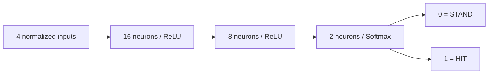

# 07 — The final neural network implementation

There is one neural network implementation to study. The website uses its saved
PyTorch weights for both computer players and human advice. It is a small
supervised classifier, not a system that learns from player wins or losses.

## The three Python files

| File | Responsibility | Start reading at |
| --- | --- | --- |
| `ai-service/model.py` | Feature generation, reference labels, normalization, architectures, checkpoint loading and conversion utilities | `hand_value`, `make_dataset`, `BlackjackNetwork` |
| `ai-service/train.py` | TensorFlow training, held-out evaluation, artifact export | `train` |
| `ai-service/blackjack_ai_api.py` | Strict input validation, startup loading, HTTP prediction/explanation responses | `HandState`, `create_app` |

`models/blackjack_nn.keras` is the saved TensorFlow model.
`models/blackjack_nn.pt` contains the matching PyTorch state dictionary and
preprocessing metadata. `models/evaluation.json` records actual measured training
results and artifact fingerprints. There is one pair of model files.

`tests/test_model.py` checks this implementation. The small `tests/conftest.py`
adds `ai-service` to Python's import path because that directory name contains a
hyphen and is not a normal importable package name. It contains no model logic.
The requirements lockfile records installed packages; students do not need to
study every transitive package.

## Install and run

Create the virtual environment once. For an existing environment, activate it and
reuse its packages. From the repository root:

```sh
source ai-service/.venv/bin/activate
python -m pip install -r ai-service/requirements.txt
python -m uvicorn blackjack_ai_api:app --app-dir ai-service --host 127.0.0.1 --port 8000
```

`requirements.txt` includes the tested lockfile, giving one installation workflow
for serving, training, and tests. No training starts when Uvicorn starts.

## Four inputs and normalization

| Position | Feature | Example | Fixed divisor |
| --- | --- | --- | --- |
| 1 | Best player total | 16 | 21 |
| 2 | Visible dealer value, Ace=11 | 10 | 11 |
| 3 | Usable Ace, 0 or 1 | 0 | 1 |
| 4 | Cards in the player's hand | 2 | 20 |

The actual shared code is:

```python
SCALES = [21.0, 11.0, 1.0, float(MAX_CARDS)]

def normalize(raw):
    return np.asarray(raw, dtype=np.float32).reshape(-1, 4) / np.array(SCALES, dtype=np.float32)
```

For `[16,10,0,2]`, normalized input is approximately
`[0.7619,0.9091,0,0.1]`. The same function is called by training, conversion tests,
and FastAPI. Never change these divisors without training compatible weights.
The API verifies the divisors and feature order stored in the checkpoint.

A usable Ace currently counts as 11. Merely having an Ace does not make a hand
soft: A+A+9+K totals 21 with no usable Ace. The network never receives the hidden
dealer card, the shoe, identity, or match history.

## How training examples are generated

`reachable_hands` explores valid hands in a queue. Each step adds one possible
card value. It stops expanding a hand at 21, just like the live game. Equivalent
hands with the same minimum total, Ace presence, and card count need not be
explored repeatedly because those values determine future scoring.

Face cards are equivalent to 10 for the input features. A non-busting hand uses
fewer than the 24 copies of each rank available in six decks, so a dealer upcard
of every rank remains available. `make_dataset` combines each reachable hand's
features with dealer values 2–11 and removes duplicate feature tuples. This gives
**2,190 distinct states**, not 2,190 independent full shoe permutations.

For each tuple, `basic_strategy(total, dealer, soft)` supplies the target label:
**0 = STAND**, **1 = HIT**. These rules are the training teacher and a comparison
for explanations. The live recommendation is selected by the neural network's
forward pass, never by secretly returning the teacher's label instead.

The valid non-busting range is 2–20 cards. A 21-card hand would require all Aces
and would already stop at soft 21 after eleven Aces. A terminal 20-card hand can
contain nineteen Aces and a 2, provided the 2 arrives before the all-Ace prefix
hits 21. A hand needing another action has at most 19 cards. Invalid total/Ace/
count combinations are rejected; nothing is clipped to a smaller count.

## Architecture and forward propagation



A dense layer computes `input × weights + bias`. ReLU applies `max(0,value)` to
each neuron output. This nonlinearity allows more than one linear boundary.
The actual PyTorch forward method is:

```python
def forward(self, features):
    features = torch.relu(self.fc1(features))
    features = torch.relu(self.fc2(features))
    return torch.softmax(self.out(features), dim=1)
```

Softmax converts the two final logits into nonnegative action scores summing to
one. The action with the larger score is returned. A HIT score of 0.8 means a
model preference for that class, not an 80% probability of winning. Calibration
of these scores has not been evaluated.

The parameter count is:

| Layer | Weights | Biases | Total |
| --- | --- | --- | --- |
| Hidden 1 | 4 × 16 = 64 | 16 | 80 |
| Hidden 2 | 16 × 8 = 128 | 8 | 136 |
| Output | 8 × 2 = 16 | 2 | 18 |
| Overall | 208 | 26 | **234** |

ReLU, Softmax, and input values do not add trainable parameters.

## Training, loss, and backpropagation

To reproduce the training process while keeping the website's serving files:

```sh
# From the repository root, with the virtual environment active:
python ai-service/train.py --epochs 600 --output /tmp/blackjack-model-experiment
```

Omit `--output` only when deliberately replacing the three files in
`ai-service/models/`. FastAPI loads weights at startup, so restart it to serve a
replacement. Keep experiment files outside the active source tree.

`stratified_split` divides distinct states approximately 70/15/15 into training,
validation, and test partitions, keeping both action classes represented.
The recorded partitions contain 1,532/329/329 states. Their indices do not overlap.
Seed 42 makes ordering and initialization reproducible within the tested software
setup; different framework or hardware versions can introduce numeric differences.

`train` builds the TensorFlow architecture, trains minibatches of 32 with Adam
(initial learning rate 0.001), and watches validation loss. Its early-stopping
callback restores the best validation weights and can stop after 60 epochs
without improvement. One epoch means one pass through training data.
The recorded serving model trained for 600 epochs. The test partition is not used
for optimizer updates or early stopping.

Sparse categorical cross-entropy is `-log(score(correct action))` for one example.
A confident wrong answer incurs a larger loss. Backpropagation applies the chain
rule to calculate how every weight affects that loss; Adam uses the gradients to
update weights. These updates happen in TensorFlow's `fit`, not in the API.
Statistics from real games never update these weights.

## Why two saved formats exist

`.keras` preserves the native trained TensorFlow model. `.pt` stores the matching
PyTorch weights and compatibility metadata for deployment. They represent the
same learned classifier rather than two independent strategies.

`export_to_pytorch` copies actual Dense weights and biases into `BlackjackNetwork`.
TensorFlow kernels use `[input,output]`; PyTorch Linear uses `[output,input]`, so
kernels must be transposed. The function checks score differences and identical
actions across all generated states before saving the checkpoint. A conversion
failure raises an error instead of silently exporting different behavior.

`train.py` writes measured loss, accuracy, confusion matrix, disagreements,
per-card-count results, conversion error, versions, and artifact hashes into
`evaluation.json`. It does not invent metrics or copy previous-run numbers into
a new experiment's evaluation.

## How FastAPI uses the trained model

At startup, `create_app` calls `model.load_model` once per worker. The loader
checks architecture, labels, feature order, scales, card range, dataset version,
state-dictionary shapes, and finite weights. Missing or incompatible weights
prevent startup, so the service cannot report readiness with an unusable model.

`HandState` accepts exactly four strict integer fields. It checks bounds and
membership in generated legal states. On `/predict`, FastAPI calls `normalize`,
performs a real forward pass under `torch.inference_mode()`, and maps the largest
output to HIT/STAND. The network is in evaluation mode, and no gradients or
optimizer updates are needed. The API process does not import TensorFlow.

The response also includes a reference action, agreement flag, explanation, and
score warning. The explanation compares rules; it does not claim to reveal what
each hidden neuron means. Disagreement is reported honestly while preserving
the model's actual recommendation.

## How bots and Analysis AI share the endpoint

Express calls the same `/predict` endpoint for each feature using four trusted
values derived from the server's current hand and dealer upcard. For a bot, the
backend applies the returned legal action automatically and asks again after a
nonterminal HIT. For a human, Express returns advice without changing cards.
The person may ignore it or explicitly select the recommendation.

The frontend never calls Python directly. The dealer always follows S17 rules,
not the neural network. A Python outage pauses a bot or displays an assistant
error; no fallback is presented as model output.

## Tests and interpreting the evidence

```sh
npm run test:ai
```

The Python suite checks actual model loading, known captured predictions,
normalization, reachable hands, invalid inputs, metadata/weight failures,
load-once behavior, model/reference disagreement, artifact fingerprints,
TensorFlow/PyTorch parity, and evaluation consistency. A one-epoch training/export
smoke test uses a temporary folder, leaving the serving artifacts untouched.

The serving model's measured held-out agreement remains **327/329 = 99.39%**,
with cross-entropy **0.02203**. Its confusion matrix, rows truth STAND/HIT and
columns predictions STAND/HIT, is:

```text
216   0
  2 111
```

Across all 2,190 states it disagrees with four reference labels. The API discloses
those cases. TensorFlow/PyTorch maximum score difference is about `1.19e-7`, with
identical actions. During cleanup, pre/post PyTorch predictions were also compared
across the entire domain: all actions matched and maximum score difference was
**0.0**, with byte-identical relocated artifacts.

The split is stratified by action, not card count; it happens to have no held-out
20-card tuple. Direct API and whole-domain parity tests cover that terminal count.
Feature tuples are equally represented even though real games reach some much
more often. These are reference-imitation results, not a win-rate study, proof of
optimality, or evidence of broad generalization.

## Hands-on exercise

Read a disagreement in `models/evaluation.json`, send those four values to
`/predict`, and identify its actual network action and reference action. Trace the
normalization and forward method. Then run training into a temporary directory,
compare that experiment's actual metrics with the serving report, and explain why
a one-epoch smoke run proves the pipeline works but does not replace the 600-epoch
serving model's evaluation.
