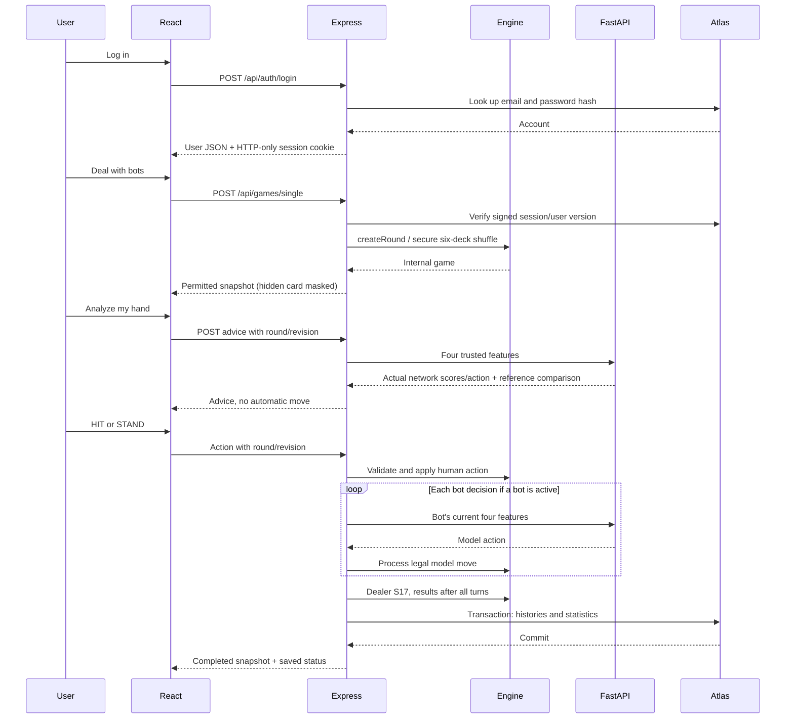

# 09 — Full system flow

Follow one real single-player round across the files. The important boundary is
who owns each decision and when a network/database operation can fail.

## Where to set breakpoints

1. `routes/index.js` login handler: input validation and password comparison.
2. `middleware/auth.js` `verifyToken`: verify signature and session version.
3. `services/games.js` `startSingle`: create participants and round.
4. `game/engine.js` `processHit`: draw and score one new card.
5. `services/ai.js`: inspect the four-feature request, never private configuration.
6. `blackjack_ai_api.py` `/predict`: normalized tensor and real forward pass.
7. `services/database.js` `saveRound`: transaction and duplicate check.
8. `components/GameTable.jsx`: display the returned snapshot.

Use a disposable account when stepping through saves. Avoid printing raw
passwords, cookies, database URIs, or whole request headers in debugging logs.

## Multiplayer differences

Login is still HTTP. `Multiplayer.jsx` then connects a cookie-authenticated socket.
The host emits `room:create`, friends emit `room:join`, and the host emits
`room:start`. A player's `game:action` enters the same engine through `roomAction`.
The server broadcasts an allowlisted `room:update` after each change; all clients
show the same cards, revision, and active player.

Multiplayer advice is a private acknowledgement to `game:advice`. It does not
broadcast an automatic action or stall other players indefinitely: the request
has a short AI timeout, while the room lock prevents inconsistent updates.
When the last human finishes, the server resolves the single shared dealer and
saves every human's outcome in one transaction. Each player compares their own
hand with that dealer; humans do not compete directly against each other.

## Failure paths to demonstrate

| Failure | Visible behavior | Recovery |
| --- | --- | --- |
| Invalid credentials | Login error | Correct credentials |
| Stale/double action | Conflict; refreshed state | Act using current turn |
| Advice service unavailable | Assistant error | Human can act or retry advice |
| Bot service unavailable | Bot pause | Restart AI and Retry AI |
| Atlas unavailable at startup | Backend does not listen | Fix connectivity and restart |
| Atlas save fails mid-session | Unsaved result message | Retry saving in same process |
| Last socket disconnects | Player stands | Rejoin for later rounds |
| Node restart | Active games/rooms lost | Start new room/round; saved history remains |

## Exercise

One member drives the UI, one traces the Express request, and one traces FastAPI.
Explain a single HIT all the way from click to updated cards. Swap roles and repeat
for advice and multiplayer. Each member should name the owner of every state change.
