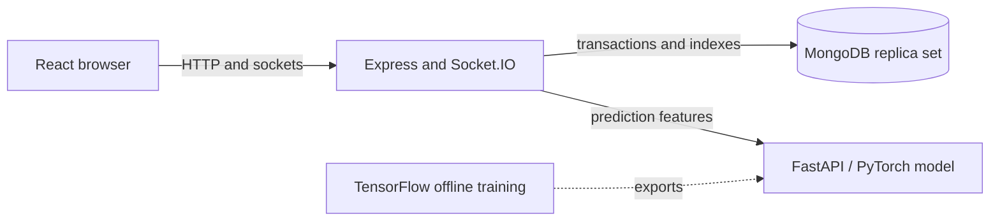
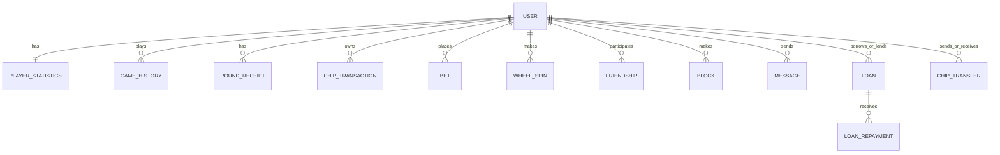

# V2 system and database architecture

The React client uses authenticated HTTP for account, wallet, games and social
operations. Socket.IO sends room snapshots and notification hints; an authenticated
social connection is separate from the multiplayer connection. Express owns card
dealing, turns, random wheel selection, financial validation and authorization.
MongoDB stores durable accounts and financial records. FastAPI serves the existing
PyTorch checkpoint; TensorFlow training remains an offline process.

| Collection | Important data and constraints |
| --- | --- |
| `User` | Unique username/email, password hash, token version, integer chip balance, reward/spin timestamps, social lock version. Balance index supports rankings. |
| `PlayerStatistics` | One document per user; lifetime game counters, wagered and returned chips. Observed RTP is computed from the latter two. |
| `GameHistory`, `RoundReceipt` | Latest 20 history rows per user; unique durable `(user, roundId)` receipt remains after pruning. |
| `ChipTransaction` | Signed change and resulting balance with a globally unique operation key; never pruned with chat. |
| `Bet` | Unique `(user, roundId)`; stake, mode, fixed payout rule and pending/settled/refunded status. |
| `WheelSpin` | Unique `(user, requestId)` receipt with selected prize and cost. |
| `Friendship`, `Block` | Canonically ordered unique friend pair and directed unique blocks. User-document writes serialize relationship changes against messaging and transfers. |
| `Message` | Conversation key, sender, recipient, text, read time and expiry; indexed for conversation and unread queries, with a TTL index. |
| `Maintenance` | Persisted weekly chat cleanup deadline and coordination version. |
| `Loan` | Lender, borrower, initiator, terms, principal, remaining balance, deadlines, status and repayment history. |
| `ChipTransfer`, `LoanRepayment` | Durable receipts with unique `(sender or borrower, requestId)` keys. |

At registration, account, statistics, opening balance and ledger entry commit
together. Legacy users without a balance are initialized lazily without changing
history. A daily claim and a wheel spin each update all affected records in a
transaction. Starting a round commits all human wagers together; settlement
commits ledger entries, bet statuses, histories and lifetime statistics together.
On a single-server restart, pending wagers are refunded, not resumed. Running two
servers against the same database is unsupported because startup recovery cannot
distinguish another server's live round.

Private messages require an accepted, unblocked relationship. A serialized write
retains the newest 20 per conversation; expiry and a persisted weekly cleanup
remove text, not financial receipts or debt. The client also refreshes open chat
periodically so TTL deletions eventually disappear even if the TTL monitor removed
a document before the application cleanup saw it.

Loan acceptance moves principal once after both parties consent; repayment moves
chips in the opposite direction. Overdue checks use server time and are enforced
even between scheduled status updates. Loans remain repayable after a relationship
is removed or blocked. Public net rankings show balance minus aggregate outstanding
debt; they do not expose individual counterparties or loan records.

Before deployment, back up the existing database and use Atlas or a replica set;
never drop or reset collections. Keep `.env` private and do not overwrite it.
Use a single backend instance with synchronized system time. A future multi-instance
deployment needs durable game ownership/leases and coordinated recovery, shared
presence, and a scalable queue or notification adapter.
